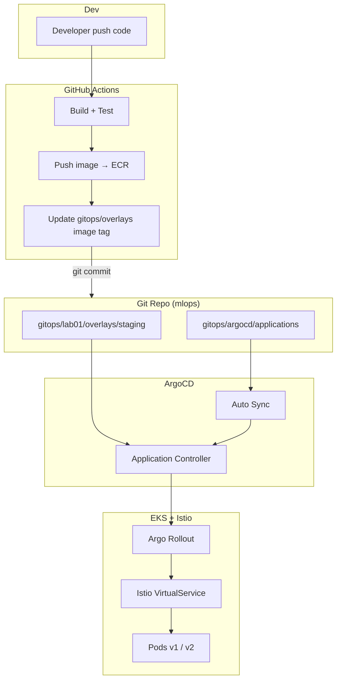
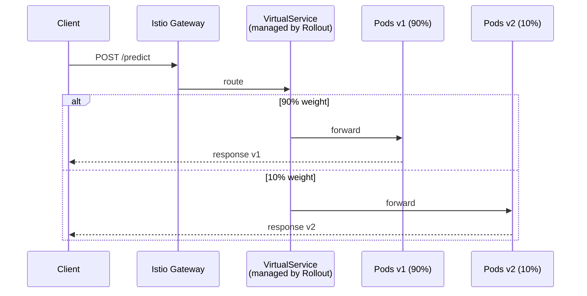
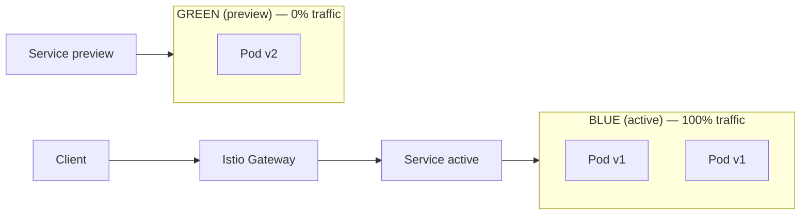
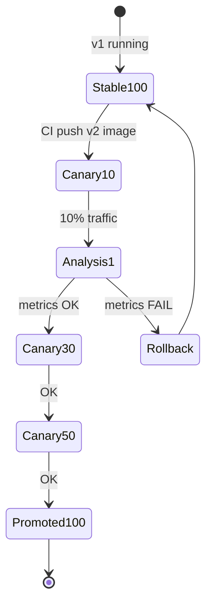
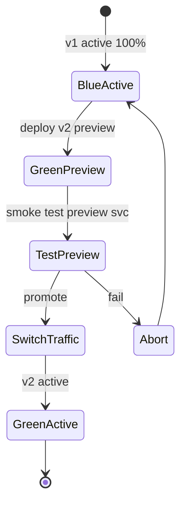
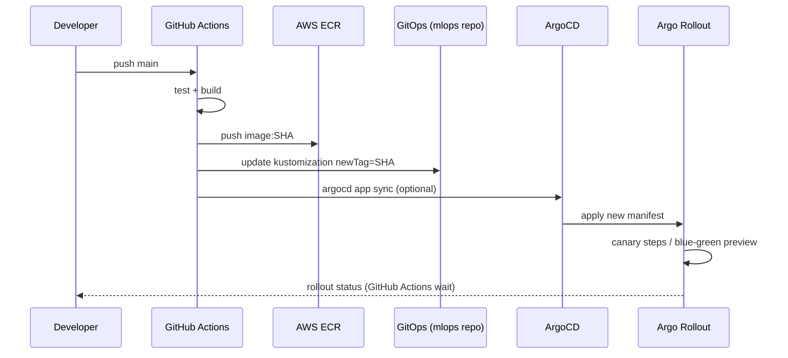

# ArgoCD — Canary & Blue/Green Deployment với CI/CD

> **Stack:** GitHub Actions → ECR → GitOps (repo mlops) → ArgoCD → Argo Rollouts + Istio  
> **Labs:** Lab 1 (Iris), Lab 5 (KServe), Lab 8 (vLLM)

---

## Mục lục

1. [Kiến trúc GitOps](#1-kiến-trúc-gitops)
2. [Workflow Canary vs Blue/Green](#2-workflow-canary-vs-bluegreen)
3. [Cài ArgoCD + Argo Rollouts](#3-cài-argocd--argo-rollouts)
4. [Cấu trúc GitOps trong repo](#4-cấu-trúc-gitops-trong-repo)
5. [Triển khai Canary (Lab 1)](#5-triển-khai-canary-lab-1)
6. [Triển khai Blue/Green (Lab 1)](#6-triển-khai-bluegreen-lab-1)
7. [Tích hợp CI/CD GitHub Actions](#7-tích-hợp-cicd-github-actions)
8. [Promote & Rollback](#8-promote--rollback)
9. [Test sau deploy](#9-test-sau-deploy)
10. [Troubleshooting](#10-troubleshooting)

---

## 1. Kiến trúc GitOps



### Luồng request khi Canary (10% traffic v2)



### Luồng request khi Blue/Green



Sau promote: Green → Active, Blue scale down.

---

## 2. Workflow Canary vs Blue/Green

| | **Canary** | **Blue/Green** |
|---|-----------|----------------|
| Traffic shift | Từ từ 10→20→50→100% | 0% preview → 100% switch |
| Risk | Thấp hơn (test incremental) | Switch nhanh |
| Rollback | Giảm weight về 0 | Switch lại Blue |
| Tool | Argo Rollouts + Istio weights | Argo Rollouts blueGreen |
| ML use case | Model v2 A/B test | Major version swap |
| CI trigger | Update image tag → auto canary steps | Update tag → deploy preview → manual promote |

### Canary steps (Argo Rollouts)



### Blue/Green steps



---

## 3. Cài ArgoCD + Argo Rollouts

### 3.1 ArgoCD (minikube / EKS)

```bash
kubectl create namespace argocd

# Stable ArgoCD
kubectl apply -n argocd -f https://raw.githubusercontent.com/argoproj/argo-cd/stable/manifests/install.yaml

# Hoặc Helm
helm repo add argo https://argoproj.github.io/argo-helm
helm install argocd argo/argo-cd -n argocd --create-namespace

# Password initial
kubectl -n argocd get secret argocd-initial-admin-secret \
  -o jsonpath="{.data.password}" | base64 -d; echo

# Port-forward UI
kubectl port-forward svc/argocd-server -n argocd 8080:443
# https://localhost:8080  user: admin
```

### 3.2 Argo Rollouts

```bash
kubectl create namespace argo-rollouts
kubectl apply -n argo-rollouts -f https://github.com/argoproj/argo-rollouts/releases/latest/download/install.yaml

# CLI (optional)
brew install argoproj/tap/kubectl-argo-rollouts

# Dashboard
kubectl argo rollouts dashboard
```

### 3.3 Istio (bắt buộc cho canary traffic split)

```bash
istioctl install --set profile=demo -y
kubectl label namespace mlops istio-injection=enabled --overwrite
```

### 3.4 ArgoCD CLI

```bash
brew install argocd
argocd login localhost:8080 --username admin --password <password> --insecure
```

---

## 4. Cấu trúc GitOps trong repo

```
gitops/
├── argocd/
│   ├── projects/mlops-project.yaml
│   └── applications/
│       ├── lab01-canary-staging.yaml
│       └── lab01-bluegreen-staging.yaml
├── lab01/
│   ├── base/
│   │   ├── kustomization.yaml
│   │   ├── rollout-canary.yaml
│   │   ├── rollout-bluegreen.yaml
│   │   ├── service.yaml
│   │   ├── service-preview.yaml
│   │   ├── analysis-template.yaml
│   │   └── istio/
│   │       ├── gateway.yaml
│   │       └── virtualservice.yaml
│   └── overlays/
│       ├── staging-canary/
│       │   ├── kustomization.yaml
│       │   └── patch-image.yaml
│       └── staging-bluegreen/
│           ├── kustomization.yaml
│           └── patch-image.yaml
```

---

## 5. Triển khai Canary (Lab 1)

### 5.1 Apply ArgoCD Application

```bash
# Project + App
kubectl apply -f gitops/argocd/projects/mlops-project.yaml
kubectl apply -f gitops/argocd/applications/lab01-canary-staging.yaml

# Verify
argocd app get lab01-iris-canary-staging
argocd app sync lab01-iris-canary-staging
```

### 5.2 CI push image mới → canary tự chạy

Khi GitHub Actions cập nhật `newTag` trong overlay và commit:

```yaml
# gitops/lab01/overlays/staging-canary/kustomization.yaml
images:
  - name: iris-classifier
    newTag: abc1234   # ← CI update
```

ArgoCD sync → Rollout detect image change → canary steps: 10% → 30% → 50% → 100%.

### 5.3 Theo dõi canary

```bash
kubectl argo rollouts get rollout iris-classifier -n mlops
kubectl argo rollouts status rollout iris-classifier -n mlops --watch

# Traffic weight hiện tại
kubectl argo rollouts get rollout iris-classifier -n mlops --watch
```

### 5.4 Manual promote / abort

```bash
# Promote ngay lên 100%
kubectl argo rollouts promote rollout iris-classifier -n mlops

# Abort — rollback về stable
kubectl argo rollouts abort rollout iris-classifier -n mlops
kubectl argo rollouts undo rollout iris-classifier -n mlops
```

---

## 6. Triển khai Blue/Green (Lab 1)

### 6.1 Apply Application

```bash
kubectl apply -f gitops/argocd/applications/lab01-bluegreen-staging.yaml
argocd app sync lab01-iris-bluegreen-staging
```

### 6.2 Workflow

1. CI push image v2 → ArgoCD sync
2. Rollout tạo **preview** pods (green), active vẫn v1 (blue)
3. Test preview service (không có production traffic):

```bash
kubectl port-forward svc/iris-classifier-preview -n mlops 8081:8000
curl http://localhost:8081/health
curl -X POST http://localhost:8081/predict -H "Content-Type: application/json" \
  -d @labs/lab01/sample.json
```

4. Promote:

```bash
kubectl argo rollouts promote rollout iris-classifier-bg -n mlops
```

5. Blue pods scale down, green trở thành active.

### 6.3 Rollback blue/green

```bash
kubectl argo rollouts abort rollout iris-classifier-bg -n mlops
kubectl argo rollouts undo rollout iris-classifier-bg -n mlops
```

---

## 7. Tích hợp CI/CD GitHub Actions

### 7.1 Flow CI/CD + ArgoCD



### 7.2 GitHub Secrets cần thêm

| Secret | Mô tả |
|--------|-------|
| `AWS_ROLE_ARN` | OIDC AWS (đã có) |
| `ARGOCD_SERVER` | `argocd.example.com` hoặc `localhost:8080` |
| `ARGOCD_AUTH_TOKEN` | ArgoCD API token |

Tạo token:

```bash
argocd account generate-token
```

### 7.3 Workflow files

| Workflow | Mục đích |
|----------|----------|
| `argocd-canary-deploy.yml` | Build → update gitops → sync → wait rollout |
| `argocd-bluegreen-deploy.yml` | Build → sync → test preview → promote (manual) |
| `argocd-promote.yml` | Manual promote rollout |
| `argocd-rollback.yml` | Manual abort + undo |

### 7.4 GitOps update pattern (CI step)

```bash
# Cập nhật image tag trong overlay
cd gitops/lab01/overlays/staging-canary
kustomize edit set image iris-classifier=${ECR_REGISTRY}/iris-classifier:${GITHUB_SHA}
git add kustomization.yaml
git commit -m "deploy(canary): iris-classifier ${GITHUB_SHA}"
git push
```

---

## 8. Promote & Rollback

### 8.1 Quyết định promote

| Signal | Canary | Blue/Green |
|--------|--------|------------|
| Error rate | < 1% ở 10% traffic | Preview smoke test pass |
| Latency p95 | < baseline + 20% | Preview p95 OK |
| Model metric | accuracy không drop | A/B metric OK |
| Manual | `kubectl argo rollouts promote` | `promote` sau preview test |

### 8.2 Rollback nhanh

```bash
# Canary / Blue-Green
kubectl argo rollouts undo rollout iris-classifier -n mlops

# Hoặc revert git tag
git revert HEAD && git push
argocd app sync lab01-iris-canary-staging
```

---

## 9. Test sau deploy

### 9.1 Test canary traffic split

```bash
chmod +x scripts/test-argocd-canary.sh
./scripts/test-argocd-canary.sh
```

### 9.2 Test thủ công

```bash
GW="http://$(minikube ip):$(kubectl get svc istio-ingressgateway -n istio-system \
  -o jsonpath='{.spec.ports[?(@.name==\"http2\")].nodePort}')"

# Gửi 50 requests, quan sát version metadata
for i in $(seq 1 50); do
  curl -s -H "Host: iris.lab.local" "$GW/metadata" | python3 -c "import sys,json; print(json.load(sys.stdin).get('version','?'))"
done | sort | uniq -c

# Rollout status
kubectl argo rollouts get rollout iris-classifier -n mlops
```

### 9.3 Test blue/green preview

```bash
# Preview (green) — không qua gateway production
kubectl run test-preview -n mlops --image=curlimages/curl --rm -it --restart=Never -- \
  curl -sf http://iris-classifier-preview:8000/health

# Active (blue) — qua gateway
curl -H "Host: iris.lab.local" "$GW/health"
```

---

## 10. Troubleshooting

| Lỗi | Fix |
|-----|-----|
| ArgoCD OutOfSync | `argocd app sync --force` |
| Rollout stuck | `kubectl argo rollouts get rollout ...` xem message |
| Canary 503 | Check Istio VirtualService + subset labels |
| Analysis failed | Prometheus chưa có metrics → tạm disable analysis |
| ImagePullBackOff | ECR credentials / image tag sai |
| GitOps không update | CI chưa commit overlay / ArgoCD chưa auto-sync |

```bash
argocd app diff lab01-iris-canary-staging
kubectl describe rollout iris-classifier -n mlops
kubectl logs -n argo-rollouts deploy/argo-rollouts
```

---

## Tóm tắt commands

```bash
# Deploy canary via ArgoCD
kubectl apply -f gitops/argocd/applications/lab01-canary-staging.yaml
argocd app sync lab01-iris-canary-staging

# Watch rollout
kubectl argo rollouts status rollout iris-classifier -n mlops --watch

# Promote / Rollback
kubectl argo rollouts promote rollout iris-classifier -n mlops
kubectl argo rollouts undo rollout iris-classifier -n mlops

# CI trigger (GitHub Actions)
# → .github/workflows/argocd-canary-deploy.yml
```

---

*Manifests: `gitops/` | Workflows: `.github/workflows/argocd-*.yml`*
