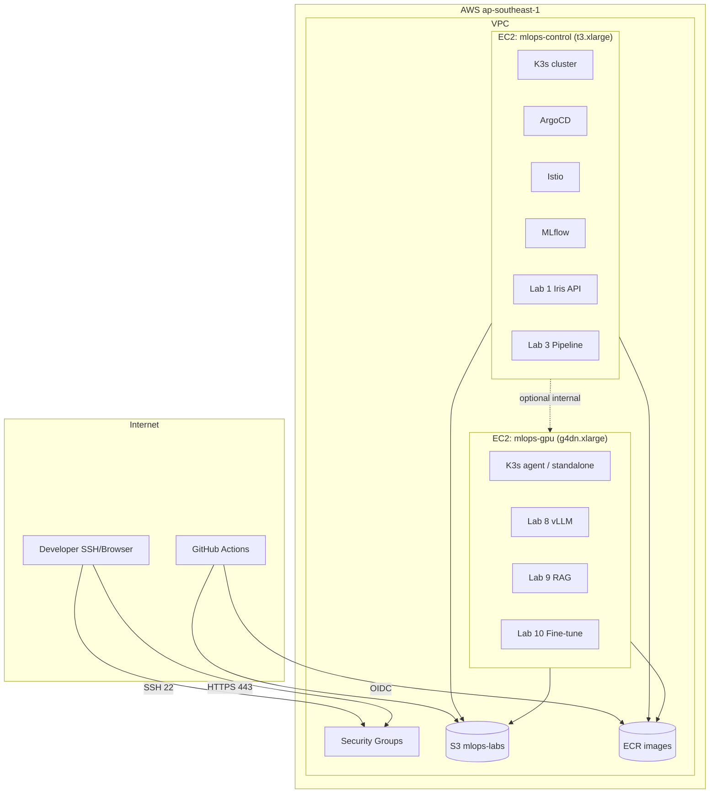
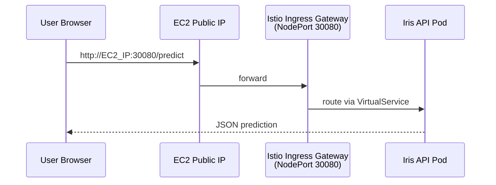

# Triển Khai MLOps Labs Trên AWS EC2

> **Region khuyến nghị:** `ap-southeast-1` (Singapore)  
> **Chi phí ước tính:** ~$50–150/tháng (tắt instance khi không dùng)  
> **Repo:** [github.com/vibecoder202019/mlops](https://github.com/vibecoder202019/mlops)

---

## Mục lục

1. [Kiến trúc triển khai EC2](#1-kiến-trúc-triển-khai-ec2)
2. [Chọn mô hình triển khai](#2-chọn-mô-hình-triển-khai)
3. [Chuẩn bị AWS](#3-chuẩn-bị-aws)
4. [Triển khai bằng Terraform](#4-triển-khai-bằng-terraform)
5. [Bootstrap EC2](#5-bootstrap-ec2)
6. [Triển khai từng Lab trên EC2](#6-triển-khai-từng-lab-trên-ec2)
7. [EKS với EC2 worker nodes](#7-eks-với-ec2-worker-nodes)
8. [GPU instance cho Lab 8–10](#8-gpu-instance-cho-lab-810)
9. [Domain, HTTPS, bảo mật](#9-domain-https-bảo-mật)
10. [Chi phí & tắt resources](#10-chi-phí--tắt-resources)
11. [Troubleshooting](#11-troubleshooting)

---

## 1. Kiến trúc triển khai EC2

### 1.1 Mô hình 3-tier (khuyến nghị)



### 1.2 Mapping Lab → EC2 / Instance type

| Lab | Nơi chạy | Instance | Ghi chú |
|-----|----------|----------|---------|
| Lab 1 | mlops-control | t3.xlarge | Docker hoặc K3s |
| Lab 2 | mlops-gpu | g4dn.xlarge | GPU benchmark |
| Lab 3–4 | mlops-control | t3.xlarge | DVC + MLflow + S3 |
| Lab 5–7 | mlops-control (K3s) | t3.xlarge | KServe, KFP, cost |
| Lab 8 | mlops-gpu | g4dn.xlarge | vLLM bắt buộc GPU |
| Lab 9 | mlops-gpu | g4dn.xlarge | RAG + vLLM |
| Lab 10 | mlops-gpu | g4dn.xlarge | LoRA fine-tune |
| Istio/ArgoCD | mlops-control | t3.xlarge | Control plane |
| CI/CD | GitHub Actions | — | Build → ECR → GitOps |

### 1.3 Luồng request trên EC2 (Lab 1 + Istio)



---

## 2. Chọn mô hình triển khai

| Mô hình | EC2 | Phù hợp | Chi phí/tháng |
|---------|-----|---------|---------------|
| **A. All-in-one** | 1× t3.xlarge | Lab 1–7, học nhanh | ~$120 |
| **B. Control + GPU** | t3.xlarge + g4dn.xlarge | Lab 1–10 đầy đủ | ~$350 (8h/ngày) |
| **C. EKS + EC2 nodes** | EKS + node groups | Production-like | ~$200+ |
| **D. Spot GPU** | g4dn spot | Lab 8–10 tiết kiệm | ~$80–150 |

**Khuyến nghị cho bạn:** Bắt đầu **Mô hình A** → thêm **g4dn spot** khi vào Lab 8.

---

## 3. Chuẩn bị AWS

### 3.1 Cài AWS CLI (máy local)

```bash
aws configure
# AWS Access Key ID, Secret, region ap-southeast-1, output json
```

### 3.2 Tạo S3 bucket + ECR

```bash
export AWS_REGION=ap-southeast-1
export S3_BUCKET=mlops-labs-$(aws sts get-caller-identity --query Account --output text)
export PROJECT=mlops

aws s3 mb s3://${S3_BUCKET} --region ${AWS_REGION}

for repo in iris-classifier housing-price-api vllm-server embedding-service rag-api finetune-trainer; do
  aws ecr create-repository --repository-name $repo --region ${AWS_REGION} 2>/dev/null || true
done

# Budget alert $80/month (Console → Billing → Budgets)
```

### 3.3 Tạo key pair SSH

```bash
aws ec2 create-key-pair \
  --key-name mlops-labs-key \
  --query 'KeyMaterial' \
  --output text > ~/.ssh/mlops-labs-key.pem

chmod 400 ~/.ssh/mlops-labs-key.pem
```

### 3.4 IAM Role cho EC2 (S3 + ECR)

Terraform sẽ tạo role `mlops-ec2-role` với policy:
- `s3:GetObject`, `s3:PutObject`, `s3:ListBucket` trên bucket labs
- `ecr:GetAuthorizationToken`, `ecr:BatchGetImage`, `ecr:PutImage`

---

## 4. Triển khai bằng Terraform

### 4.1 Cấu trúc

```
infra/ec2/terraform/
├── main.tf
├── variables.tf
├── outputs.tf
├── security-groups.tf
├── iam.tf
├── ec2-control.tf
├── ec2-gpu.tf
└── user-data/
    ├── control-bootstrap.sh
    └── gpu-bootstrap.sh
```

### 4.2 Deploy

```bash
cd infra/ec2/terraform

cp terraform.tfvars.example terraform.tfvars
# Sửa: key_name, s3_bucket, allowed_ssh_cidr (IP của bạn /32)

terraform init
terraform plan
terraform apply

# Lấy output
terraform output control_public_ip
terraform output gpu_public_ip
terraform output ssh_control
```

### 4.3 terraform.tfvars mẫu

```hcl
aws_region       = "ap-southeast-1"
project_name     = "mlops"
environment      = "labs"
key_name         = "mlops-labs-key"
s3_bucket        = "mlops-labs-123456789012"
allowed_ssh_cidr = "YOUR.IP.ADDRESS/32"   # BẮT BUỘC giới hạn SSH
enable_gpu_node  = true
control_instance_type = "t3.xlarge"
gpu_instance_type     = "g4dn.xlarge"
use_spot_gpu          = true
```

---

## 5. Bootstrap EC2

Sau `terraform apply`, EC2 tự chạy user-data cài:

| Tool | Version | Dùng cho |
|------|---------|----------|
| Docker | latest | Lab 1, build images |
| k3s | latest | K8s single-node |
| kubectl | match k3s | Deploy manifests |
| Helm | 3.x | KServe, ArgoCD |
| AWS CLI v2 | latest | S3, ECR |
| Python 3.11 | apt | Training scripts |
| Git | apt | Clone repo |

### 5.1 SSH vào control node

```bash
ssh -i ~/.ssh/mlops-labs-key.pem ubuntu@$(terraform output -raw control_public_ip)
```

### 5.2 Clone repo trên EC2

```bash
git clone https://github.com/vibecoder202019/mlops.git
cd mlops
```

### 5.3 Chạy bootstrap bổ sung (nếu cần)

```bash
sudo bash infra/ec2/scripts/setup-control-node.sh
```

---

## 6. Triển khai từng Lab trên EC2

### Lab 1 — Iris Classifier (Docker trực tiếp)

**Cách nhanh nhất trên EC2 (không K8s):**

```bash
cd ~/mlops/labs/lab01
python3 -m venv .venv && source .venv/bin/activate
pip install -r requirements.txt
python train.py

# Chạy API (port 8000)
nohup python serve.py > /var/log/iris-api.log 2>&1 &

# Test local
curl http://localhost:8000/health
```

**Security Group:** mở port `8000` từ IP của bạn (hoặc qua Nginx reverse proxy port 443).

**Docker trên EC2:**

```bash
python train.py
docker build -t iris-classifier:1.0.0 .
docker run -d --name iris-api -p 8000:8000 --restart unless-stopped iris-classifier:1.0.0
```

**K3s trên EC2:**

```bash
bash ~/mlops/infra/ec2/scripts/deploy-lab01-k3s.sh
# Truy cập: http://EC2_PUBLIC_IP:30080/health (NodePort)
```

---

### Lab 2 — GPU trên EC2 g4dn

```bash
# SSH vào GPU node
ssh -i ~/.ssh/mlops-labs-key.pem ubuntu@$(terraform output -raw gpu_public_ip)

# Verify GPU
nvidia-smi

# Hugging Face + PyTorch GPU
cd ~/mlops/labs/lab02
python3 -m venv .venv && source .venv/bin/activate
pip install torch transformers --index-url https://download.pytorch.org/whl/cu121
pip install sentencepiece

# Chạy benchmark (tạo hf_sentiment.py theo lab guide)
python hf_sentiment.py
```

**Lưu ý:** AMI phải có NVIDIA driver (Deep Learning AMI hoặc user-data cài driver).

---

### Lab 3–4 — MLOps Pipeline trên EC2

```bash
cd ~/mlops/labs/lab03
python3 -m venv .venv && source .venv/bin/activate
pip install -r requirements.txt "dvc[s3]" mlflow

# Cấu hình DVC remote
dvc init
dvc remote add -d storage s3://${S3_BUCKET}/dvc-storage
dvc remote modify storage region ap-southeast-1

# MLflow server (chạy nền)
export MLFLOW_TRACKING_URI=http://localhost:5000
nohup mlflow server \
  --host 0.0.0.0 --port 5000 \
  --backend-store-uri sqlite:///mlflow.db \
  --default-artifact-root s3://${S3_BUCKET}/mlflow-artifacts \
  > /var/log/mlflow.log 2>&1 &

# Security Group: mở port 5000 (chỉ IP của bạn)
# UI: http://EC2_IP:5000
```

CI/CD GitHub Actions vẫn build từ GitHub → ECR; EC2 pull image deploy.

---

### Lab 5–7 — K3s + Istio + ArgoCD trên EC2 control

```bash
# Cài platform stack
bash ~/mlops/infra/ec2/scripts/setup-k3s-platform.sh

# Script này cài:
# - k3s (nếu chưa có)
# - Istio demo profile
# - Argo Rollouts
# - ArgoCD
# - Namespace mlops

# Deploy Lab 1 qua GitOps
kubectl apply -f ~/mlops/gitops/argocd/projects/mlops-project.yaml
kubectl apply -f ~/mlops/gitops/argocd/applications/lab01-canary-staging.yaml

# Port-forward ArgoCD UI
kubectl port-forward svc/argocd-server -n argocd 8080:443 &
# https://localhost:8080  user: admin
```

**Truy cập Istio Gateway trên EC2:**

```bash
# NodePort của istio-ingressgateway
kubectl get svc istio-ingressgateway -n istio-system
# http://EC2_PUBLIC_IP:<nodeport>/health  (Host: iris.lab.local)
```

---

### Lab 8 — vLLM trên EC2 GPU

```bash
# Trên GPU node
ssh -i ~/.ssh/mlops-labs-key.pem ubuntu@GPU_IP

# Docker + NVIDIA runtime
docker run --gpus all -d --name vllm \
  -p 8000:8000 \
  --ipc=host \
  -v ~/.cache/huggingface:/root/.cache/huggingface \
  vllm/vllm-openai:latest \
  --model meta-llama/Llama-3.2-1B-Instruct \
  --max-model-len 4096

# Security Group: mở 8000
curl http://GPU_IP:8000/v1/models

curl http://GPU_IP:8000/v1/chat/completions \
  -H "Content-Type: application/json" \
  -d '{
    "model": "meta-llama/Llama-3.2-1B-Instruct",
    "messages": [{"role":"user","content":"What is MLOps?"}],
    "max_tokens": 100
  }'
```

**Hoặc deploy lên K3s GPU node:**

```bash
bash ~/mlops/infra/ec2/scripts/deploy-lab08-vllm-k3s.sh
```

---

### Lab 9 — RAG Platform trên EC2 GPU

```bash
bash ~/mlops/infra/ec2/scripts/deploy-lab09-rag-docker-compose.sh
# Qdrant + Embedding + vLLM + RAG API qua docker-compose
# http://GPU_IP:8080/query
```

---

### Lab 10 — Fine-tuning trên EC2 GPU

```bash
cd ~/mlops/labs/lab10
source .venv/bin/activate
pip install transformers peft trl mlflow bitsandbytes accelerate

export MLFLOW_TRACKING_URI=http://CONTROL_IP:5000
python src/finetune_lora.py
```

---

## 7. EKS với EC2 worker nodes

Nếu muốn môi trường giống production hơn K3s:

```bash
# Trên máy local (không phải EC2)
cd ~/mlops/infra/ec2/scripts

# Cài eksctl
brew install eksctl

eksctl create cluster \
  --name mlops-lab-cluster \
  --region ap-southeast-1 \
  --nodes 2 \
  --node-type t3.medium \
  --with-oidc

# GPU node group (spot)
eksctl create nodegroup \
  --cluster mlops-lab-cluster \
  --name gpu-spot \
  --node-type g4dn.xlarge \
  --nodes 0 --nodes-min 0 --nodes-max 1 \
  --spot \
  --node-taints nvidia.com/gpu=true:NoSchedule

# Deploy gitops
kubectl apply -f gitops/argocd/applications/lab01-canary-staging.yaml
```

Chi tiết CI/CD: `docs/MLOPS-LABS-CICD-GUIDE.md`

---

## 8. GPU instance cho Lab 8–10

### 8.1 AMI khuyến nghị

| AMI | Dùng khi |
|-----|----------|
| Ubuntu 22.04 + user-data cài driver | Terraform template repo |
| Deep Learning AMI (Ubuntu) | Nhanh, driver có sẵn |
| Amazon Linux 2023 + NVIDIA | EKS GPU nodes |

### 8.2 Kiểm tra GPU

```bash
nvidia-smi
docker run --rm --gpus all nvidia/cuda:12.0-base nvidia-smi
```

### 8.3 Tiết kiệm chi phí GPU

```bash
# Dùng Spot (Terraform: use_spot_gpu = true)
# Tắt instance khi không lab
aws ec2 stop-instances --instance-ids i-xxx

# Hoặc schedule
bash ~/mlops/infra/ec2/scripts/stop-all-lab-instances.sh
```

---

## 9. Domain, HTTPS, bảo mật

### 9.1 Nginx reverse proxy (EC2)

```bash
sudo apt install nginx certbot python3-certbot-nginx

# /etc/nginx/sites-available/mlops
# proxy_pass http://127.0.0.1:8000 (Lab 1)
# proxy_pass http://127.0.0.1:30080 (Istio gateway)

sudo certbot --nginx -d mlops.yourdomain.com
```

### 9.2 Security Group checklist

| Port | Protocol | Source | Service |
|------|----------|--------|---------|
| 22 | TCP | Your IP/32 only | SSH |
| 443 | TCP | 0.0.0.0/0 hoặc IP bạn | HTTPS |
| 8000 | TCP | Your IP/32 | Lab API (dev) |
| 30080 | TCP | Your IP/32 | Istio NodePort |
| 6443 | TCP | VPC CIDR | K3s API (internal) |

**Không mở** port 5000 (MLflow), 8080 (ArgoCD) ra internet — dùng SSH tunnel:

```bash
ssh -i ~/.ssh/mlops-labs-key.pem -L 8080:localhost:8080 ubuntu@EC2_IP
# ArgoCD: https://localhost:8080
```

---

## 10. Chi phí & tắt resources

### 10.1 Ước tính chi phí (ap-southeast-1)

| Resource | On-demand | Spot |
|----------|-----------|------|
| t3.xlarge | ~$0.18/h ≈ $130/tháng | — |
| g4dn.xlarge | ~$0.65/h ≈ $470/tháng | ~$0.25/h |
| S3 50GB | ~$1.5/tháng | — |
| ECR | ~$1/tháng | — |

**Mẹo:** Chạy 3h/ngày × 22 ngày ≈ $40 (control) + $35 (GPU spot).

### 10.2 Scripts quản lý

```bash
# Tắt tất cả lab instances
bash infra/ec2/scripts/stop-all-lab-instances.sh

# Bật lại
bash infra/ec2/scripts/start-all-lab-instances.sh

# Destroy terraform
cd infra/ec2/terraform && terraform destroy
```

---

## 11. Troubleshooting

| Lỗi | Fix |
|-----|-----|
| SSH timeout | Check Security Group port 22 + your IP |
| Cannot pull ECR | `aws ecr get-login-password \| docker login` |
| k3s not ready | `sudo systemctl status k3s` |
| GPU not found | Reboot, check `nvidia-smi`, DL AMI |
| S3 AccessDenied | IAM role attached to EC2? |
| Port not accessible | SG + ufw (`sudo ufw allow`) |
| Out of memory t3 | Giảm replicas hoặc upgrade t3.2xlarge |

```bash
# Logs
sudo journalctl -u k3s -f
docker logs iris-api
kubectl get pods -A
kubectl describe pod -n mlops <pod>
```

---

## Quick reference — lệnh theo lab

```bash
# Lab 1 Docker
cd labs/lab01 && python train.py && docker run -d -p 8000:8000 iris-classifier:1.0.0

# Lab 1 K3s
bash infra/ec2/scripts/deploy-lab01-k3s.sh

# Platform (Istio + ArgoCD)
bash infra/ec2/scripts/setup-k3s-platform.sh

# Lab 8 vLLM GPU
bash infra/ec2/scripts/deploy-lab08-vllm-docker.sh

# Test
curl http://localhost:8000/health
./scripts/test-istio-lab01.sh
./scripts/test-argocd-canary.sh

# Stop $$$
bash infra/ec2/scripts/stop-all-lab-instances.sh
```

---

*Terraform: `infra/ec2/terraform/` | Scripts: `infra/ec2/scripts/`*
