# Istio Integration — Workflow & Hướng Dẫn Sử Dụng

> **Áp dụng cho:** Lab 1 (Iris API), Lab 5 (KServe), Lab 8 (vLLM), Lab 9 (RAG)  
> **Môi trường:** minikube / EKS + Istio 1.22+

---

## Mục lục

1. [Tổng quan request flow](#1-tổng-quan-request-flow)
2. [Workflow không có Istio vs có Istio](#2-workflow-không-có-istio-vs-có-istio)
3. [Workflow từng lab](#3-workflow-từng-lab)
4. [Cài Istio trên Kubernetes](#4-cài-istio-trên-kubernetes)
5. [Tích hợp Lab 1 với Istio](#5-tích-hợp-lab-1-với-istio)
6. [Traffic management — Canary & A/B](#6-traffic-management--canary--ab)
7. [Security — mTLS](#7-security--mtls)
8. [Observability](#8-observability)
9. [Test request khi có Istio](#9-test-request-khi-có-istio)
10. [Troubleshooting](#10-troubleshooting)

---

## 1. Tổng quan request flow

### 1.1 Kiến trúc MLOps Platform (big picture)

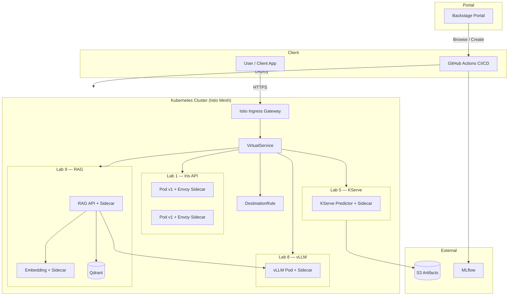

### 1.2 Một HTTP request đi qua Istio như thế nào

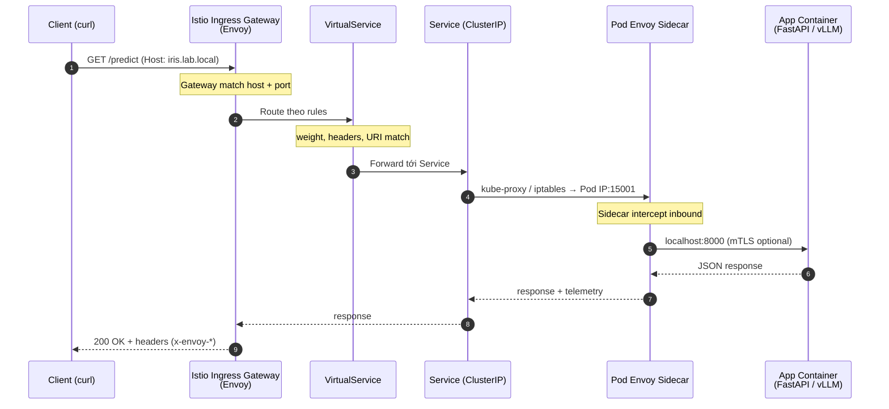

**Điểm quan trọng:**
- Mọi traffic vào Pod đi qua **Envoy sidecar** (port 15001 inbound)
- App container vẫn listen port 8000 bình thường
- Istio control plane (**istiod**) push config xuống Envoy

---

## 2. Workflow không có Istio vs có Istio

### 2.1 Lab 1 — Không Istio (NodePort trực tiếp)

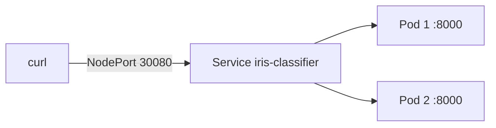

```
Client → NodePort → kube-proxy round-robin → Pod (FastAPI)
```

**Hạn chế:** Không canary, không mTLS, không metrics per-request chuẩn, không retry/timeout policy tập trung.

### 2.2 Lab 1 — Có Istio (Gateway → VirtualService)

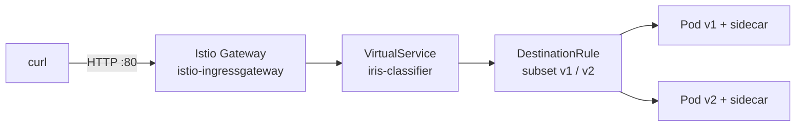

```
Client → Ingress Gateway → VirtualService (routing rules)
       → DestinationRule (subsets, load balance)
       → Pod sidecar → App
```

### 2.3 So sánh nhanh

| Tính năng | Không Istio | Có Istio |
|-----------|-------------|----------|
| Expose service | NodePort / LB | Gateway + VirtualService |
| Canary deploy | kubectl rollout / manual | Traffic weight 90/10 |
| mTLS pod-to-pod | Không | STRICT mode |
| Retry / timeout | Code app | VirtualService policy |
| Metrics/tracing | Tự cài | Kiali, Jaeger, Prometheus tích hợp |
| KServe canary | KServe built-in | Istio + KServe native |

---

## 3. Workflow từng lab

### 3.1 Lab 1 — Predict request flow

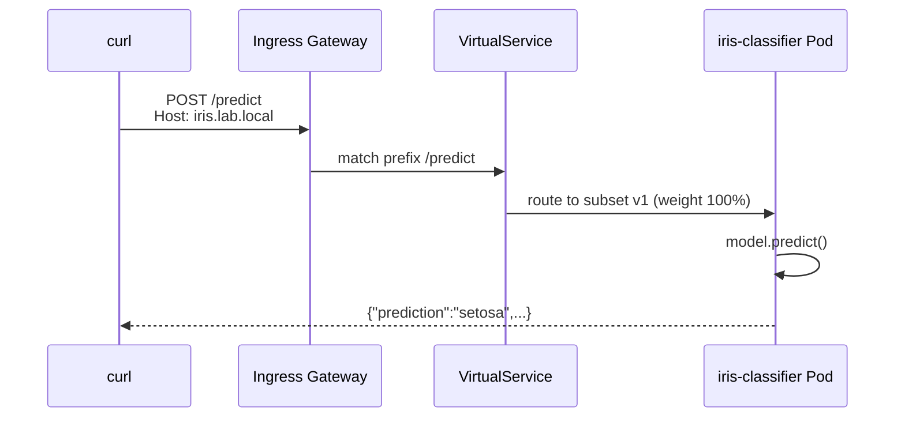

### 3.2 Lab 5 — KServe + Istio (canary model)

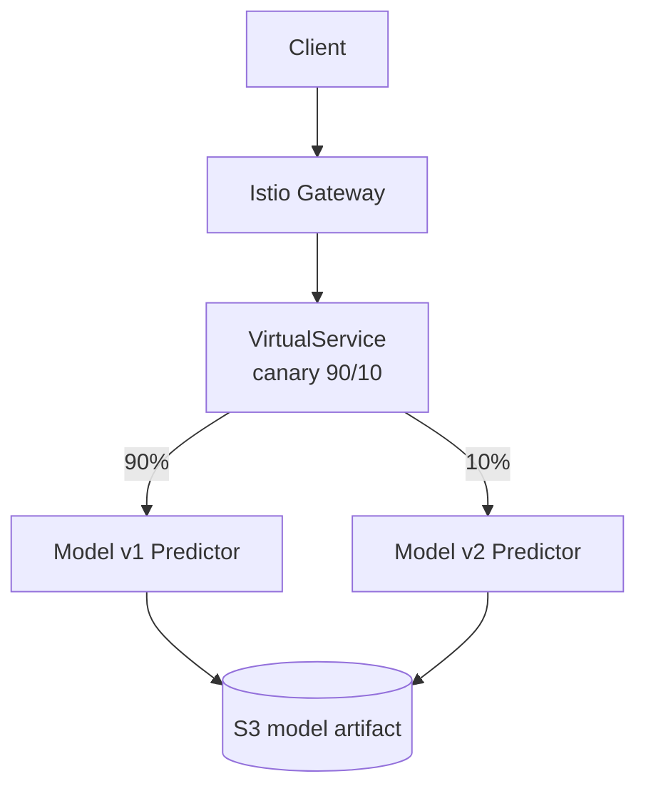

KServe mặc định dùng **Knative + Istio** cho canary traffic split.

### 3.3 Lab 8 — vLLM request flow

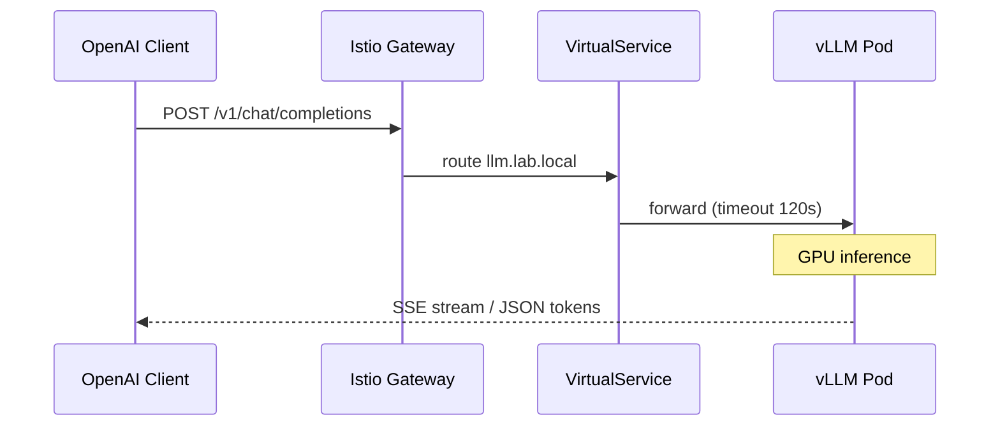

**Lưu ý:** LLM inference lâu → cấu hình `timeout` và `retries` trong VirtualService.

### 3.4 Lab 9 — RAG end-to-end flow

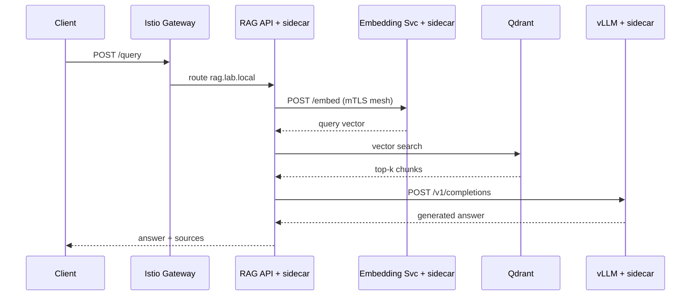

Mesh nội bộ: RAG → Embedding → Qdrant → vLLM đều qua sidecar (mTLS, telemetry).

### 3.5 CI/CD + Istio deploy flow

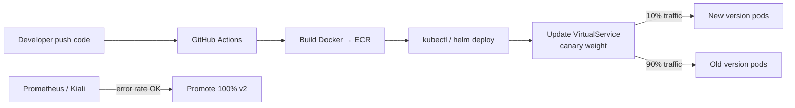

---

## 4. Cài Istio trên Kubernetes

### 4.1 minikube (Lab local)

```bash
# Bật minikube
minikube start --cpus=4 --memory=8192

# Cài istioctl
brew install istioctl
# hoặc: curl -L https://istio.io/downloadIstio | sh -

# Cài Istio demo profile (đủ Gateway + Kiali + Prometheus)
istioctl install --set profile=demo -y

# Bật sidecar injection cho namespace
kubectl label namespace default istio-injection=enabled
kubectl create namespace mlops --dry-run=client -o yaml | kubectl apply -f -
kubectl label namespace mlops istio-injection=enabled

# Verify
kubectl get pods -n istio-system
istioctl version
```

### 4.2 EKS

```bash
istioctl install --set profile=default -y

# Hoặc với NLB cho Ingress Gateway
istioctl install -y \
  --set profile=default \
  --set values.gateways.istio-ingressgateway.type=LoadBalancer

kubectl label namespace staging istio-injection=enabled
kubectl label namespace production istio-injection=enabled
```

### 4.3 Addons (Kiali, Prometheus, Jaeger)

```bash
kubectl apply -f https://raw.githubusercontent.com/istio/istio/release-1.22/samples/addons/kiali.yaml
kubectl apply -f https://raw.githubusercontent.com/istio/istio/release-1.22/samples/addons/prometheus.yaml
kubectl apply -f https://raw.githubusercontent.com/istio/istio/release-1.22/samples/addons/jaeger.yaml

# Truy cập Kiali
istioctl dashboard kiali
# Prometheus
istioctl dashboard prometheus
```

---

## 5. Tích hợp Lab 1 với Istio

Manifest có sẵn tại: `labs/lab01/k8s/istio/`

### 5.1 Deploy Lab 1 + Istio

```bash
cd labs/lab01

# 1. Train + build image
python train.py
eval $(minikube docker-env)
docker build -t iris-classifier:1.0.0 .

# 2. Deploy app (namespace mlops, injection enabled)
kubectl apply -n mlops -f k8s/deployment.yaml
kubectl apply -n mlops -f k8s/service.yaml

# 3. Chờ pods 2/2 (app + sidecar)
kubectl get pods -n mlops -w
# READY 2/2

# 4. Apply Istio routing
kubectl apply -n mlops -f k8s/istio/

# 5. Lấy Gateway URL
export GW_URL=$(minikube ip)
export GW_PORT=$(kubectl get svc istio-ingressgateway -n istio-system -o jsonpath='{.spec.ports[?(@.name=="http2")].nodePort}')
echo "Gateway: http://${GW_URL}:${GW_PORT}"
```

### 5.2 Files Istio Lab 1

| File | Chức năng |
|------|-----------|
| `gateway.yaml` | Mở port 80, host `iris.lab.local` |
| `virtualservice.yaml` | Route `/health`, `/predict`, `/metadata` |
| `destinationrule.yaml` | Subsets v1/v2, load balancer |
| `virtualservice-canary.yaml` | Canary 90/10 (optional) |
| `peerauthentication.yaml` | mTLS STRICT (optional) |

### 5.3 /etc/hosts (local test)

```bash
# Thêm vào /etc/hosts
echo "$(minikube ip) iris.lab.local" | sudo tee -a /etc/hosts
```

---

## 6. Traffic management — Canary & A/B

### 6.1 Workflow canary 90/10

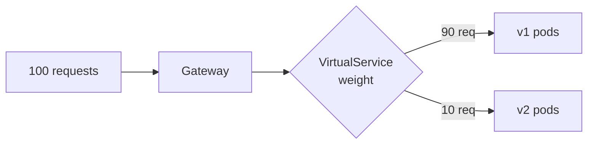

Deploy v2 song song v1:

```bash
# Deploy v2 với label version=v2
kubectl apply -f k8s/istio/deployment-v2.yaml

# Apply canary VirtualService
kubectl apply -f k8s/istio/virtualservice-canary.yaml
```

### 6.2 Header-based routing (A/B test)

```yaml
# Route user có header x-test-group: beta → v2
http:
  - match:
      - headers:
          x-test-group:
            exact: beta
    route:
      - destination:
          host: iris-classifier
          subset: v2
  - route:
      - destination:
          host: iris-classifier
          subset: v1
```

Test:

```bash
curl -H "x-test-group: beta" http://${GW_URL}:${GW_PORT}/predict -d '...'
```

### 6.3 Promote canary → 100%

```bash
kubectl apply -f k8s/istio/virtualservice.yaml   # v1 100%
# hoặc sửa weight v2=100 trong virtualservice-canary.yaml
```

---

## 7. Security — mTLS

### 7.1 Workflow mTLS trong mesh

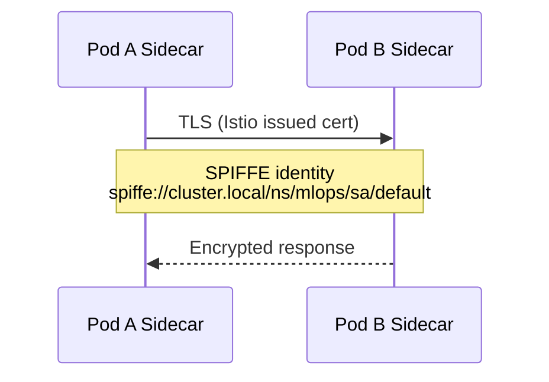

### 7.2 Bật STRICT mTLS

```bash
kubectl apply -f k8s/istio/peerauthentication.yaml
# mode: STRICT cho namespace mlops
```

Verify:

```bash
istioctl authn tls-check iris-classifier.mlops.svc.cluster.local
```

---

## 8. Observability

### 8.1 Metrics flow

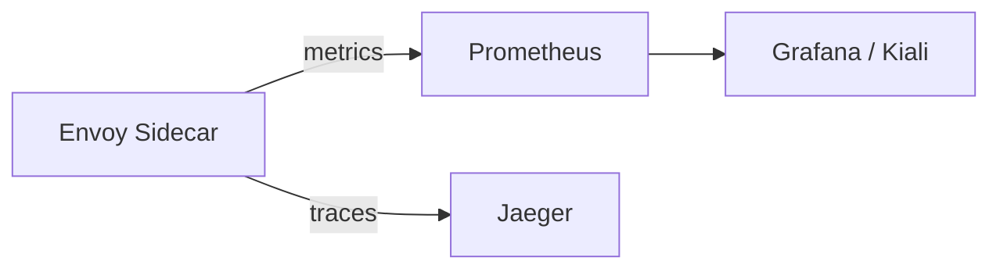

### 8.2 Metrics hữu ích cho ML serving

| Metric | Ý nghĩa |
|--------|---------|
| `istio_requests_total` | Request count |
| `istio_request_duration_milliseconds` | Latency p50/p95 |
| `istio_tcp_sent_bytes` | LLM streaming |
| `envoy_cluster_upstream_rq_5xx` | Error rate |

```bash
# Kiali — xem graph traffic Lab 1
istioctl dashboard kiali
# Chọn namespace: mlops, app: iris-classifier
```

---

## 9. Test request khi có Istio

### 9.1 Script tự động

```bash
chmod +x scripts/test-istio-lab01.sh
./scripts/test-istio-lab01.sh
```

### 9.2 Test thủ công — từng bước

#### Bước 1: Kiểm tra mesh health

```bash
# Sidecar injected?
kubectl get pods -n mlops
# READY phải 2/2

# Proxy sync?
istioctl proxy-status

# Config đã push?
istioctl proxy-config routes deploy/iris-classifier -n mlops
```

#### Bước 2: Health check qua Gateway

```bash
export GW_HOST="iris.lab.local"
export GW_URL="http://$(minikube ip):$(kubectl get svc istio-ingressgateway -n istio-system -o jsonpath='{.spec.ports[?(@.name=="http2")].nodePort}')"

curl -v -H "Host: ${GW_HOST}" "${GW_URL}/health"
```

**Response mong đợi:**

```json
{"status":"ok","model_loaded":true}
```

**Headers Istio/Envoy thường thấy:**

```
server: istio-envoy
x-envoy-upstream-service-time: 5
```

#### Bước 3: Predict request

```bash
curl -s -H "Host: ${GW_HOST}" \
  -H "Content-Type: application/json" \
  -X POST "${GW_URL}/predict" \
  -d '{"sepal_length":5.1,"sepal_width":3.5,"petal_length":1.4,"petal_width":0.2}' | jq
```

#### Bước 4: Metadata

```bash
curl -s -H "Host: ${GW_HOST}" "${GW_URL}/metadata" | jq
```

#### Bước 5: Test canary (nếu deploy v2)

```bash
# Gửi 100 requests, đếm response version
for i in $(seq 1 100); do
  curl -s -H "Host: ${GW_HOST}" "${GW_URL}/metadata" | jq -r .version
done | sort | uniq -c
# Kỳ vọng: ~90 v1.0.0, ~10 v2.0.0
```

#### Bước 6: Test header routing

```bash
curl -s -H "Host: ${GW_HOST}" \
  -H "x-test-group: beta" \
  -H "Content-Type: application/json" \
  -X POST "${GW_URL}/predict" \
  -d '{"sepal_length":5.9,"sepal_width":3.0,"petal_length":5.1,"petal_width":1.8}' | jq
```

#### Bước 7: Test từ trong mesh (service-to-service)

```bash
kubectl run curl-test -n mlops --image=curlimages/curl --rm -it --restart=Never -- \
  curl -sf http://iris-classifier:8000/health
```

Request này cũng qua sidecar (mTLS nếu bật STRICT).

#### Bước 8: Load test qua Istio

```bash
hey -n 500 -c 10 -m POST \
  -H "Host: iris.lab.local" \
  -H "Content-Type: application/json" \
  -D labs/lab01/sample.json \
  "${GW_URL}/predict"
```

Xem latency trên Kiali trong lúc chạy.

#### Bước 9: Debug một request

```bash
# Access log sidecar
kubectl logs -n mlops -l app=iris-classifier -c istio-proxy --tail=20

# Trace (nếu bật Jaeger)
istioctl dashboard jaeger
```

### 9.3 Test checklist

| # | Test | Pass criteria |
|---|------|---------------|
| 1 | Pod READY 2/2 | Sidecar injected |
| 2 | `istioctl proxy-status` | SYNCED |
| 3 | GET /health qua Gateway | 200 + istio-envoy header |
| 4 | POST /predict | prediction JSON |
| 5 | In-mesh curl | 200 từ pod khác |
| 6 | Canary 100 req | ~90/10 split |
| 7 | Header beta | route tới v2 |
| 8 | Kiali graph | traffic visible |

---

## 10. Troubleshooting

| Triệu chứng | Nguyên nhân | Fix |
|-------------|-------------|-----|
| Pod READY 1/2 | Sidecar chưa inject | `kubectl label ns mlops istio-injection=enabled`, redeploy |
| 503 UC | Upstream connection fail | Check service port, app health |
| 404 NR | No route match | VirtualService host/path sai |
| Connection refused Gateway | NodePort / LB chưa mở | Check `istio-ingressgateway` svc |
| Host không resolve | Thiếu /etc/hosts | Thêm `minikube ip iris.lab.local` |
| mTLS fail | STRICT nhưng pod chưa inject | Inject all pods trong namespace |
| Timeout LLM | Inference lâu | Tăng timeout VirtualService |

```bash
# Debug routing
istioctl analyze -n mlops
istioctl proxy-config cluster deploy/iris-classifier -n mlops

# Xem config VirtualService
kubectl get virtualservice -n mlops -o yaml
```

---

## Tóm tắt

```
                    ┌─────────────────────────────────┐
                    │         Client Request           │
                    └───────────────┬─────────────────┘
                                    ▼
                    ┌─────────────────────────────────┐
                    │    Istio Ingress Gateway (Envoy)   │
                    └───────────────┬─────────────────┘
                                    ▼
                    ┌─────────────────────────────────┐
                    │         VirtualService           │
                    │  (route, weight, timeout, retry) │
                    └───────────────┬─────────────────┘
                                    ▼
                    ┌─────────────────────────────────┐
                    │        DestinationRule           │
                    │     (subsets v1/v2, LB policy)   │
                    └───────────────┬─────────────────┘
                                    ▼
              ┌─────────────────────┴─────────────────────┐
              ▼                                           ▼
    ┌──────────────────┐                       ┌──────────────────┐
    │ Pod + Sidecar v1 │                       │ Pod + Sidecar v2 │
    │   FastAPI :8000  │                       │   FastAPI :8000  │
    └──────────────────┘                       └──────────────────┘
```

**Bước tiếp theo:** Lab 5 KServe native Istio canary → Lab 8 vLLM timeout tuning → Lab 9 full mesh RAG.

---

*Manifests: `labs/lab01/k8s/istio/` | Script test: `scripts/test-istio-lab01.sh`*
