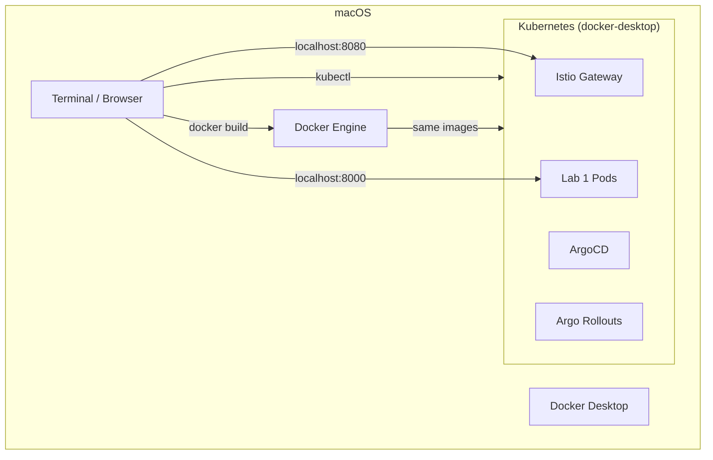
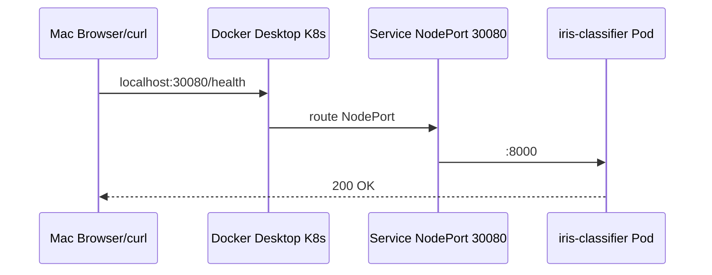
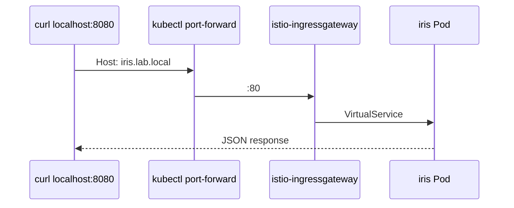

# Thực Hành MLOps Labs Trên macOS — Docker Desktop Kubernetes

> **Môi trường:** macOS (Intel hoặc Apple Silicon M1/M2/M3)  
> **K8s:** Docker Desktop built-in Kubernetes  
> **Ưu điểm:** Không cần minikube/kind, Docker + kubectl cùng một daemon  
> **Repo:** [github.com/vibecoder202019/mlops](https://github.com/vibecoder202019/mlops)

---

## Mục lục

1. [Tổng quan](#1-tổng-quan)
2. [Cài đặt & cấu hình Docker Desktop](#2-cài-đặt--cấu-hình-docker-desktop)
3. [Setup một lần](#3-setup-một-lần)
4. [Workflow request trên Mac](#4-workflow-request-trên-mac)
5. [Lab 1 — Iris Classifier](#5-lab-1--iris-classifier)
6. [Lab 2 — GPU / AI (Mac)](#6-lab-2--gpu--ai-mac)
7. [Lab 3–4 — MLOps Pipeline (local)](#7-lab-34--mlops-pipeline-local)
8. [Lab 5–7 — Platform trên K8s](#8-lab-57--platform-trên-k8s)
9. [Lab 8–10 — LLM trên Mac](#9-lab-810--llm-trên-mac)
10. [Istio trên Docker Desktop](#10-istio-trên-docker-desktop)
11. [ArgoCD trên Docker Desktop](#11-argocd-trên-docker-desktop)
12. [Giới hạn Mac vs EC2/EKS](#12-giới-hạn-mac-vs-ec2eks)
13. [Troubleshooting macOS](#13-troubleshooting-macos)

---

## 1. Tổng quan

### 1.1 Kiến trúc trên Mac



### 1.2 So sánh minikube vs Docker Desktop

| | **Docker Desktop K8s** | **minikube** |
|---|------------------------|--------------|
| Cài thêm | Không (có sẵn trong DD) | `brew install minikube` |
| Docker build | Trực tiếp, K8s thấy image ngay | Cần `eval $(minikube docker-env)` |
| LoadBalancer | Pending (dùng NodePort/port-forward) | `minikube tunnel` |
| RAM | Shared với Docker Desktop | Riêng VM |
| **Khuyến nghị Mac** | ✅ Hàng ngày | Backup / CI local |

### 1.3 Labs khả thi trên Mac Docker Desktop

| Lab | Mac Docker Desktop | Ghi chú |
|-----|-------------------|---------|
| Lab 1 | ✅ Đầy đủ | Docker + K8s + Istio |
| Lab 2 | ✅ CPU / Ollama | Không có NVIDIA GPU |
| Lab 3–4 | ✅ Local Python | MLflow local, S3 optional |
| Lab 5 | ⚠️ Nặng | KServe cần ~8GB RAM |
| Lab 6 | ⚠️ Rất nặng | Kubeflow ~12GB+ RAM |
| Lab 7 | ✅ Docs/scripts | Cost logic, không cần cloud |
| Lab 8 | ⚠️ CPU only | Ollama thay vLLM GPU |
| Lab 9 | ⚠️ docker-compose | Qdrant + Ollama |
| Lab 10 | ⚠️ CPU chậm | Model nhỏ only |

---

## 2. Cài đặt & cấu hình Docker Desktop

### 2.1 Cài Docker Desktop

```bash
brew install --cask docker
# Hoặc tải: https://www.docker.com/products/docker-desktop/
```

Mở **Docker Desktop** → đợi engine running (icon cá voi trên menu bar).

### 2.2 Bật Kubernetes

1. Docker Desktop → **Settings** (⚙️)
2. **Kubernetes** → ✅ **Enable Kubernetes**
3. **Kubernetes version:** stable (v1.29+)
4. **Apply & Restart** (chờ 2–5 phút)

Verify:

```bash
kubectl config use-context docker-desktop
kubectl get nodes
# NAME             STATUS   ROLES           AGE   VERSION
# docker-desktop   Ready    control-plane   ...   v1.29.x
```

### 2.3 Tăng tài nguyên (quan trọng)

Settings → **Resources**:

| Setting | Khuyến nghị | Khi chạy Istio+ArgoCD |
|---------|-------------|------------------------|
| CPUs | 4 | 6 |
| Memory | 8 GB | 12–16 GB |
| Disk | 60 GB | 80 GB |
| Swap | 2 GB | 4 GB |

Apple Silicon: bật **Use Virtualization framework** (nhanh hơn).

### 2.4 Cài tools bổ sung

```bash
brew install kubectl helm istioctl kustomize hey

# Argo Rollouts plugin
brew install argoproj/tap/kubectl-argo-rollouts

# Clone repo (nếu chưa có)
git clone https://github.com/vibecoder202019/mlops.git
cd mlops
```

---

## 3. Setup một lần

Chạy script tự động:

```bash
cd ~/mlops   # hoặc path repo của bạn
bash infra/macos/scripts/setup-docker-desktop.sh
```

Script sẽ:
- Verify Docker Desktop + K8s
- Tạo namespace `mlops`
- (Optional) Cài Istio demo profile
- (Optional) Cài Argo Rollouts + ArgoCD

---

## 4. Workflow request trên Mac

### 4.1 Lab 1 — không Istio (NodePort)



### 4.2 Lab 1 — có Istio (port-forward Gateway)



**Lưu ý Mac:** LoadBalancer trên Docker Desktop thường `<pending>` — dùng **NodePort** hoặc **port-forward**.

---

## 5. Lab 1 — Iris Classifier

### 5.1 Bước 1 — Train & test local

```bash
cd labs/lab01
python3 -m venv .venv && source .venv/bin/activate
pip install -r requirements.txt
python train.py
pytest tests/ -v
python serve.py
# http://localhost:8000/docs
```

### 5.2 Bước 2 — Deploy lên Docker Desktop K8s

```bash
# Từ repo root
bash infra/macos/scripts/deploy-lab01-k8s.sh
```

Hoặc thủ công:

```bash
cd labs/lab01
python train.py

# Build image — K8s Docker Desktop dùng CÙNG daemon, không cần minikube docker-env
docker build -t iris-classifier:1.0.0 .

kubectl apply -f k8s/namespace.yaml
kubectl apply -n mlops -f k8s/deployment.yaml -f k8s/service.yaml

kubectl get pods -n mlops -w
# Chờ 2/2 pods Running (nếu chưa Istio: 1/1)
```

### 5.3 Truy cập API

**Cách A — NodePort (đơn giản nhất):**

```bash
curl http://localhost:30080/health

curl -X POST http://localhost:30080/predict \
  -H "Content-Type: application/json" \
  -d @labs/lab01/sample.json
```

**Cách B — port-forward:**

```bash
kubectl port-forward -n mlops svc/iris-classifier 8000:8000
curl http://localhost:8000/health
```

### 5.4 Load test

```bash
hey -n 500 -c 10 -m POST \
  -H "Content-Type: application/json" \
  -D labs/lab01/sample.json \
  http://localhost:30080/predict
```

---

## 6. Lab 2 — GPU / AI (Mac)

Mac **không có NVIDIA GPU** trong Docker Desktop. Thay thế:

### 6.1 Hugging Face CPU

```bash
cd labs/lab02
python3 -m venv .venv && source .venv/bin/activate
pip install torch transformers sentencepiece \
  --index-url https://download.pytorch.org/whl/cpu
# Viết/chạy hf_sentiment.py theo lab guide
```

### 6.2 Ollama (Apple Silicon — nhanh cho LLM nhỏ)

```bash
brew install ollama
ollama serve &
ollama pull llama3.2:1b
ollama run llama3.2:1b "Explain MLOps"
```

### 6.3 Metal Performance Shaders (MPS) — PyTorch optional

```python
import torch
device = "mps" if torch.backends.mps.is_available() else "cpu"
print(f"Using: {device}")
```

---

## 7. Lab 3–4 — MLOps Pipeline (local)

Chạy trên Mac **không bắt buộc K8s** — Python + optional S3:

```bash
cd labs/lab03
python3 -m venv .venv && source .venv/bin/activate
pip install -r requirements.txt "dvc[s3]" mlflow 2>/dev/null || pip install mlflow pandas scikit-learn pyyaml

# MLflow local
mlflow server --host 127.0.0.1 --port 5000 &
open http://localhost:5000

# Train (khi đã có lab03 code)
# python src/train.py
```

Lab 4 validation: Great Expectations / Evidently chạy local trên Mac bình thường.

---

## 8. Lab 5–7 — Platform trên K8s

### 8.1 Cài Istio (cần cho Lab 5 KServe)

```bash
istioctl install --set profile=demo -y
kubectl label namespace mlops istio-injection=enabled --overwrite
```

### 8.2 KServe (Lab 5) — cảnh báo RAM

Cần **≥12GB** Docker Desktop memory:

```bash
kubectl apply -f https://github.com/kserve/kserve/releases/download/v0.14.0/kserve.yaml
kubectl apply -f https://github.com/kserve/kserve/releases/download/v0.14.0/kserve-cluster-resources.yaml
```

### 8.3 Kubeflow (Lab 6) — không khuyến nghị Mac

Quá nặng cho Docker Desktop. **Thay thế:** compile pipeline local:

```bash
pip install "kfp==2.9.0"
cd labs/lab06 && python pipeline/housing_pipeline.py 2>/dev/null || echo "Add pipeline code per lab guide"
```

Lab 7: đọc + chạy `scripts/cost-check.sh` local.

---

## 9. Lab 8–10 — LLM trên Mac

| Lab | Mac approach |
|-----|--------------|
| Lab 8 vLLM | **Ollama** thay vLLM GPU; hoặc vLLM CPU (rất chậm) |
| Lab 9 RAG | `docker compose` local (Qdrant + embedding CPU + Ollama) |
| Lab 10 Fine-tune | Model nhỏ + CPU/MPS; tránh 7B trên Mac |

**Ollama làm LLM backend cho Lab 8/9 trên Mac:**

```bash
brew install ollama
ollama pull llama3.2:1b
# API: http://localhost:11434/v1/chat/completions (OpenAI-compatible)
curl http://localhost:11434/v1/chat/completions -d '{
  "model": "llama3.2:1b",
  "messages": [{"role":"user","content":"Hello"}]
}'
```

---

## 10. Istio trên Docker Desktop

### 10.1 Cài & deploy Lab 1 + Istio

```bash
bash infra/macos/scripts/deploy-lab01-istio.sh
```

### 10.2 Truy cập Gateway (Mac không có External IP)

**port-forward (khuyến nghị):**

```bash
kubectl port-forward -n istio-system svc/istio-ingressgateway 8080:80

# Terminal khác
curl -H "Host: iris.lab.local" http://localhost:8080/health
curl -H "Host: iris.lab.local" -H "Content-Type: application/json" \
  -X POST http://localhost:8080/predict -d @labs/lab01/sample.json
```

**/etc/hosts (optional):**

```bash
echo "127.0.0.1 iris.lab.local" | sudo tee -a /etc/hosts
curl http://iris.lab.local:8080/health   # khi port-forward đang chạy
```

### 10.3 Test Istio

```bash
# Sửa script dùng port-forward
GW_URL=http://localhost:8080 bash scripts/test-istio-lab01.sh
```

---

## 11. ArgoCD trên Docker Desktop

### 11.1 Cài ArgoCD

```bash
bash infra/macos/scripts/setup-argocd.sh
```

### 11.2 Truy cập UI

```bash
kubectl port-forward svc/argocd-server -n argocd 8443:443

# Password
kubectl -n argocd get secret argocd-initial-admin-secret \
  -o jsonpath='{.data.password}' | base64 -d; echo

# Browser: https://localhost:8443  (user: admin, chấp nhận cert warning)
```

### 11.3 Deploy GitOps canary

```bash
kubectl apply -f gitops/argocd/projects/mlops-project.yaml

# Sửa repo URL trong application nếu fork — mặc định: vibecoder202019/mlops
kubectl apply -f gitops/argocd/applications/lab01-canary-staging.yaml

# Sync (cần argocd CLI)
brew install argocd
argocd login localhost:8443 --username admin --password <pass> --insecure
argocd app sync lab01-iris-canary-staging

kubectl argo rollouts status rollout/iris-classifier -n mlops --watch
```

---

## 12. Giới hạn Mac vs EC2/EKS

| Tính năng | Mac Docker Desktop | EC2 / EKS |
|-----------|-------------------|-----------|
| NVIDIA GPU | ❌ | ✅ g4dn |
| LoadBalancer | ❌ (pending) | ✅ |
| KServe / Kubeflow full | ⚠️ RAM limit | ✅ |
| Istio + ArgoCD | ✅ ~8GB RAM | ✅ |
| Lab 1–4 | ✅ Ideal | ✅ |
| Production-like | ⚠️ Dev only | ✅ |
| Chi phí | Free | $$ |

**Khuyến nghị lộ trình:**
1. **Mac Docker Desktop** — Lab 1–4, Istio, ArgoCD cơ bản
2. **AWS EC2** — Lab 8–10 GPU
3. **EKS** — Lab 5–7 production-like

---

## 13. Troubleshooting macOS

| Lỗi | Nguyên nhân | Fix |
|-----|-------------|-----|
| `Kubernetes failed to start` | RAM thiếu | Tăng Docker Desktop memory → 8GB+ |
| `ImagePullBackOff` | Image local chưa build | `docker build` lại, `imagePullPolicy: IfNotPresent` |
| NodePort không connect | Sai port | `kubectl get svc -n mlops` |
| LoadBalancer pending | Bình thường trên Mac | Dùng NodePort / port-forward |
| Istio 503 | Sidecar chưa inject | `kubectl label ns mlops istio-injection=enabled` |
| Pod OOMKilled | RAM thiếu | Giảm replicas hoặc tăng Docker memory |
| Apple Silicon image error | amd64 only image | Thêm `--platform linux/amd64` khi build |
| `context deadline exceeded` | Docker Desktop chậm | Restart Docker Desktop |

```bash
# Reset K8s (Docker Desktop)
# Settings → Kubernetes → Reset Kubernetes Cluster

# Debug
kubectl describe pod -n mlops <pod>
kubectl logs -n mlops <pod> -c api
docker system df
```

### Apple Silicon — build amd64 image

```bash
docker build --platform linux/amd64 -t iris-classifier:1.0.0 .
# Hoặc native arm64 (nhanh hơn nếu base image hỗ trợ)
docker build --platform linux/arm64 -t iris-classifier:1.0.0 .
```

---

## Quick reference — lệnh hàng ngày

```bash
# Context
kubectl config use-context docker-desktop
kubectl get nodes

# Lab 1 deploy
bash infra/macos/scripts/deploy-lab01-k8s.sh
curl http://localhost:30080/health

# Istio
bash infra/macos/scripts/deploy-lab01-istio.sh
kubectl port-forward -n istio-system svc/istio-ingressgateway 8080:80

# ArgoCD
kubectl port-forward -n argocd svc/argocd-server 8443:443

# Cleanup lab
kubectl delete namespace mlops --ignore-not-found
kubectl create namespace mlops
```

---

*Scripts: `infra/macos/scripts/` | Lab 1 K8s: `labs/lab01/k8s/`*
