# Platform Request Workflows — MLOps AI Platform

> Sơ đồ luồng request và workflow end-to-end cho toàn bộ platform.

---

## 1. Platform overview — ai mở rộng tới ai

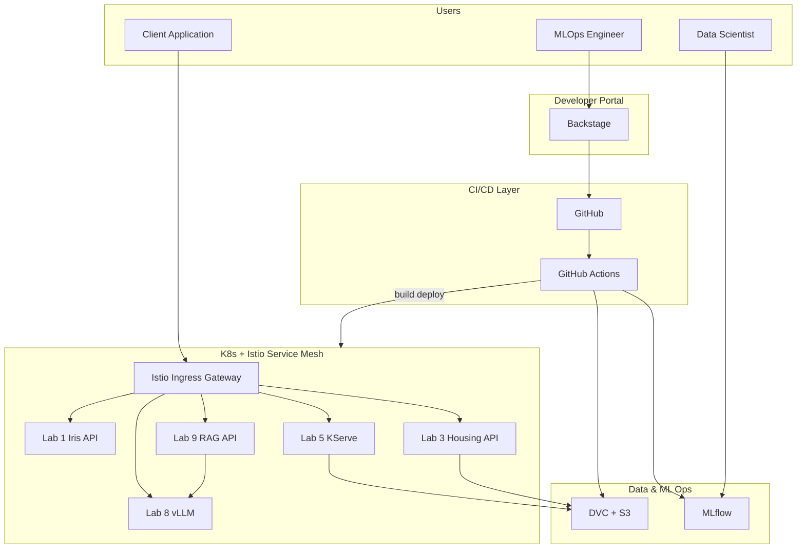

---

## 2. Lab 1 — Online inference request

**Use case:** Client gửi features → nhận prediction.

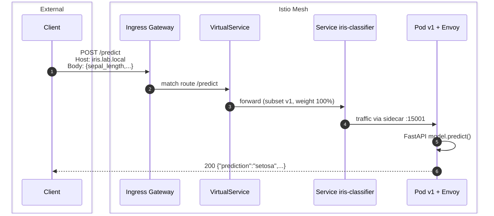

**Không qua Istio (NodePort):**

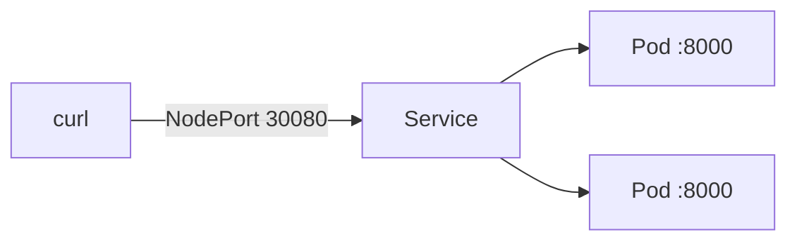

---

## 3. Lab 3 — CI/CD train & deploy request flow

**Use case:** Push code → train → deploy staging.

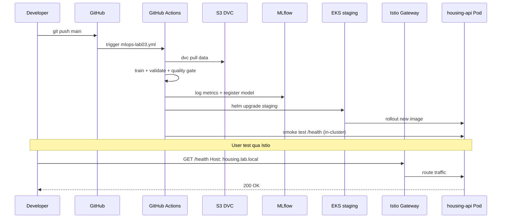

---

## 4. Lab 5 — KServe model serving + canary

**Use case:** Inference với 2 model versions, split traffic 90/10.

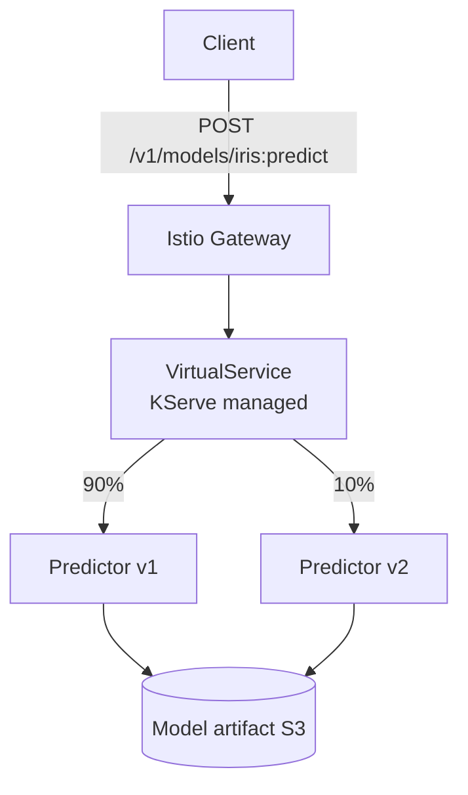

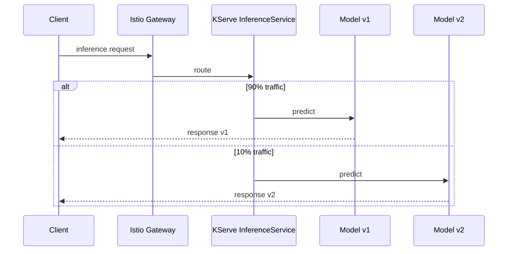

---

## 5. Lab 8 — LLM chat completion request

**Use case:** OpenAI-compatible chat API qua vLLM.

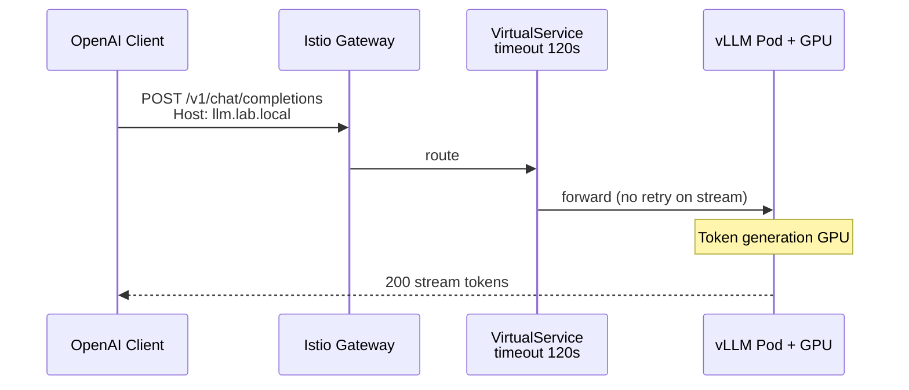

**Headers quan trọng khi test:**

```
Host: llm.lab.local
Content-Type: application/json
Authorization: Bearer <token>   # nếu bật auth
```

---

## 6. Lab 9 — RAG query request (full chain)

**Use case:** User hỏi → retrieve context → LLM trả lời.

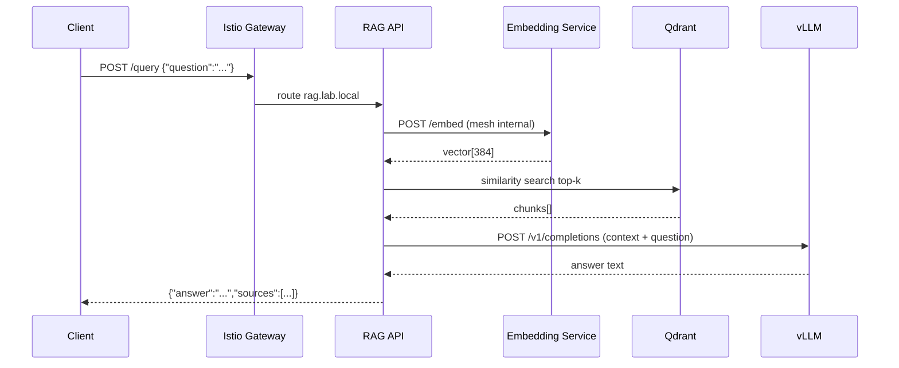

**Latency breakdown (typical):**

| Hop | Component | ~Latency |
|-----|-----------|----------|
| 1 | Gateway → RAG | 5–20ms |
| 2 | RAG → Embedding | 20–100ms |
| 3 | RAG → Qdrant | 10–50ms |
| 4 | RAG → vLLM | 500ms–5s |
| **Total** | | **0.5–6s** |

---

## 7. Canary deploy workflow (Istio)

**Use case:** Deploy model v2, test 10% traffic, promote 100%.

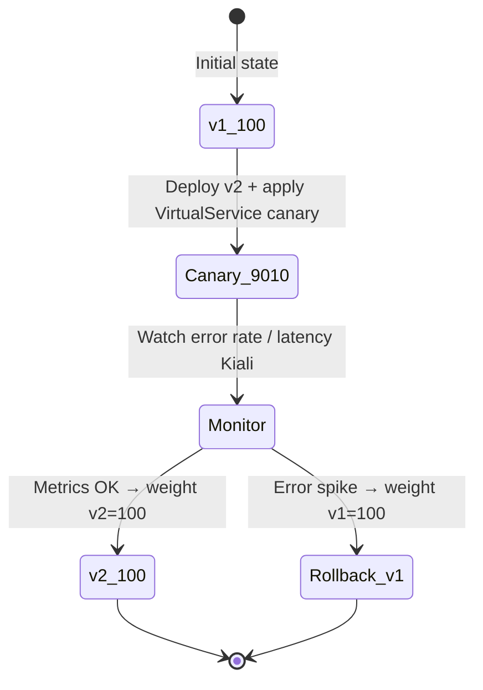

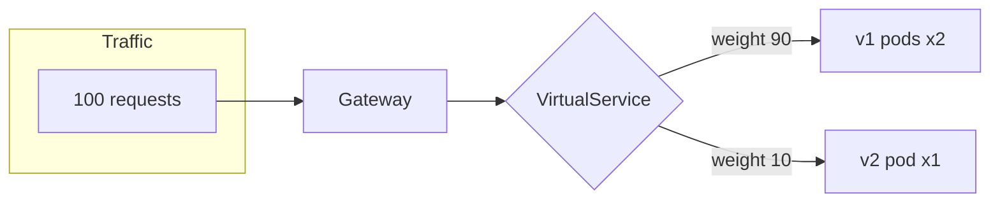

---

## 8. Backstage → Deploy → Test flow

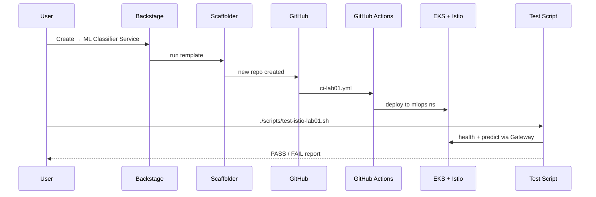

---

## 9. Request path summary table

| Lab | Entry point | Path | Backend port | Istio resources |
|-----|-------------|------|--------------|-----------------|
| Lab 1 | `iris.lab.local:80` | `/predict` | 8000 | Gateway, VS, DR |
| Lab 3 | `housing.lab.local:80` | `/health` | 8000 | Gateway, VS |
| Lab 5 | KServe host | `/v1/models/...:predict` | 8080 | KServe + Istio |
| Lab 8 | `llm.lab.local:80` | `/v1/chat/completions` | 8000 | Gateway, VS (long timeout) |
| Lab 9 | `rag.lab.local:80` | `/query` | 8080 | Gateway, VS + mesh internal |

---

## 10. Test commands nhanh (có Istio)

```bash
# Lab 1
export GW="http://$(minikube ip):$(kubectl get svc istio-ingressgateway -n istio-system -o jsonpath='{.spec.ports[?(@.name==\"http2\")].nodePort}')"
curl -H "Host: iris.lab.local" $GW/health
curl -H "Host: iris.lab.local" -H "Content-Type: application/json" \
  -X POST $GW/predict -d @labs/lab01/sample.json

# Automated
./scripts/test-istio-lab01.sh

# Kiali graph
istioctl dashboard kiali
```

Chi tiết Istio: [ISTIO-INTEGRATION-GUIDE.md](ISTIO-INTEGRATION-GUIDE.md)
